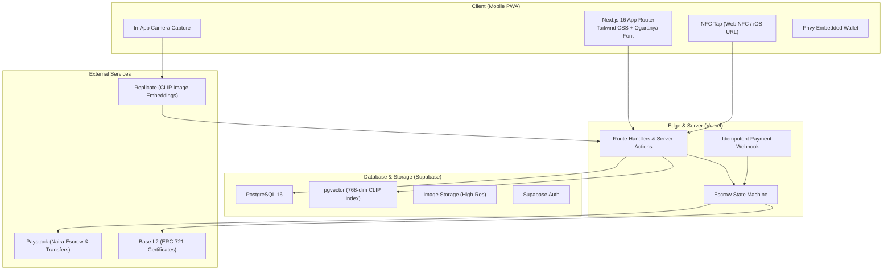
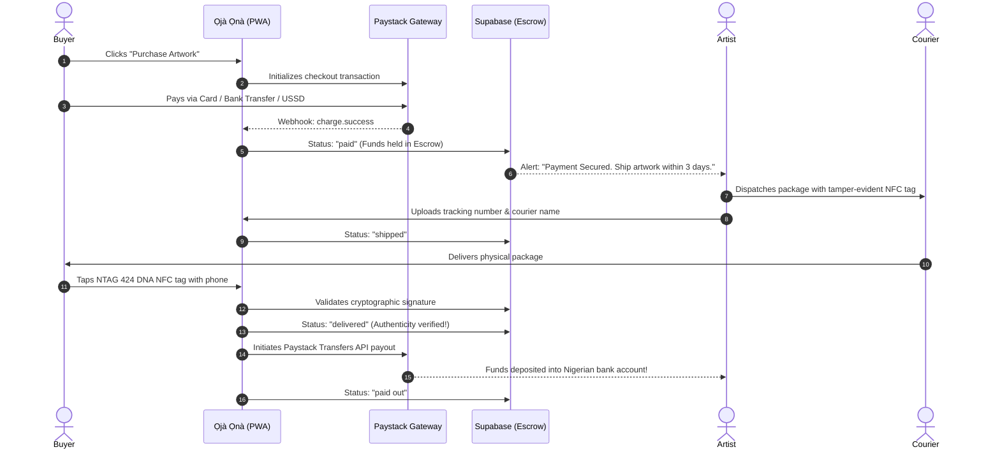

# Ọjà Ọnà

> **Physical art marketplace connecting Nigerian artists with global and local collectors.**  
> Built with Next.js 16, React 19, Supabase, `pgvector`, Base L2, and Paystack.

**Ọjà Ọnà** (*"art market"* in Yoruba) removes the friction and distrust in contemporary African art commerce. Every physical piece listed on the marketplace is paired with an on-chain digital certificate of authenticity and a physical, tamper-evident NFC tag. Buyers browse, photograph physical pieces with their phone camera to instantly search the catalog, and checkout safely with funds held in escrow until physical delivery is verified.

---

## 🚀 The 4 Pillars of Ọjà Ọnà

1. **Escrow-Backed Commerce:** Buyers pay in Naira (via Paystack) or stablecoins (USDC on Base). Money is held securely in escrow and only released to the artist once physical delivery is verified.
2. **Visual Scan-to-Search:** Visitors at galleries, cafes, or pop-up exhibitions can point their smartphone camera at any painting. AI vision embeddings (CLIP + Supabase `pgvector`) instantly identify the exact artwork or suggest visually similar pieces for sale.
3. **On-Chain Certificate of Authenticity:** When an artwork is verified, an ERC-721 token is minted on Base L2 containing permanent provenance metadata (artist, dimensions, medium, year, high-res photo hash).
4. **Tamper-Evident Physical NFC Link:** Each piece has an NTAG 424 DNA sticker affixed to the back. A smartphone tap generates a cryptographically signed URL verifying authenticity and confirming physical delivery to release escrow funds.

---

## 🏗️ Architecture: The 5 Core Engines



---

## 💻 Tech Stack

| Layer | Technology | Purpose |
| :--- | :--- | :--- |
| **Frontend Framework** | **Next.js (App Router, React 19)** | PWA capabilities, Server Components, SSR metadata for social links on WhatsApp/Instagram. |
| **Styling & UI** | **Tailwind CSS** | Mobile-first utility design system. |
| **Typography** | **Ogaranya + Inter/Manrope** | **Ogaranya** (display serif by Nebo Ikechukwu Kingsley) for branding, artwork titles, and prices; **Inter** for clean UI readability. |
| **Backend & Database** | **Supabase (PostgreSQL 16)** | Managed database, Row Level Security (RLS), image bucket storage, and auth. |
| **Vector Similarity Search** | **Supabase `pgvector` + CLIP** | Cosine distance search over 768-dimensional image vector embeddings generated via Replicate. |
| **Naira Payments & Payouts** | **Paystack** | Card, USSD, and bank transfers with escrow holding; Paystack Transfers API for artist payouts. |
| **Web3 & Wallets** | **Privy + Base L2** | Seedless embedded wallets via email/phone login; ultra-low-fee ERC-721 certificate minting on Base. |
| **Physical Verification** | **NTAG 424 DNA NFC** | Anti-tamper stickers with cryptographic SUN (Secure Unique NFC) signatures. |
| **Hosting & CI/CD** | **Vercel** | Edge network, automatic HTTPS, and preview deployments. |

---

## 🎨 Brand & Typography

- **Wordmark, Headings, Artwork Titles & ₦ Prices:** **Ogaranya Regular** by Nebo Ikechukwu Kingsley. Beautifully supports Yoruba orthography (dot-below characters `Ọ`, `ọ`, `Ẹ`, `ẹ`, `Ṣ`, `ṣ`, and tone marks `à`, `á`) and the official Naira currency symbol `₦`.
- **Body Text, Buttons, Forms & Captions:** **Inter** or **Manrope**.
- **Licensing Hygiene:** The Ogaranya font is licensed for commercial branding and web applications under the *Ogaranya Font Licence v1.0*. Font files are loaded securely as web assets and are never distributed for download or published in public repositories.

---

## 🔄 Escrow Purchase & Settlement Flow



---

## 🗄️ Core Data Model

```text
users              (id, name, email, phone, role [buyer, artist, admin], wallet_address, bank_details)
artworks           (id, artist_id, title, medium, size, year, price_ngn, price_usd, shipping_rates, status [draft, live, sold])
artwork_images     (id, artwork_id, url, embedding [vector 768], is_primary)
certificates       (id, artwork_id, token_id, contract_address, owner_wallet, nfc_tag_uid, minted_at)
orders             (id, artwork_id, buyer_id, amount, currency [NGN/USDC], payment_reference, status, tracking_number, courier, timestamps)
disputes           (id, order_id, opened_by, reason, evidence_photos, resolution, resolved_at)
```

---

## 📅 6-Week Roadmap to Launch

| Phase | Timeline | Deliverables |
| :--- | :--- | :--- |
| **Weeks 1–2** | Nov 23 – Dec 6 | Artist onboarding, catalog management, high-res photo uploads, full-text search. |
| **Weeks 3–4** | Dec 7 – Dec 20 | In-app camera visual search (CLIP + `pgvector`), Base ERC-721 certificate minting, NFC tag linkage. |
| **Weeks 5–6** | Dec 21 – Jan 3 | Paystack checkout, escrow state machine, admin dispute management, Paystack Transfers API payouts. |
| **Beta Week** | Jan 4 – Jan 10 | End-to-end beta run with 10 selected Nigerian artists. |
| **Launch Pop-up**| Jan 16, 2027 | Live launch pop-up exhibition in Lagos with NFC-tagged physical artworks. |

---

## 📄 License & Safety

Private repository for Ọjà Ọnà. All intellectual property, trademarks, and artwork imagery are protected under applicable copyright laws.
