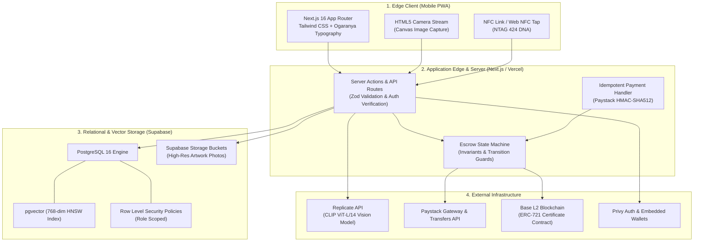
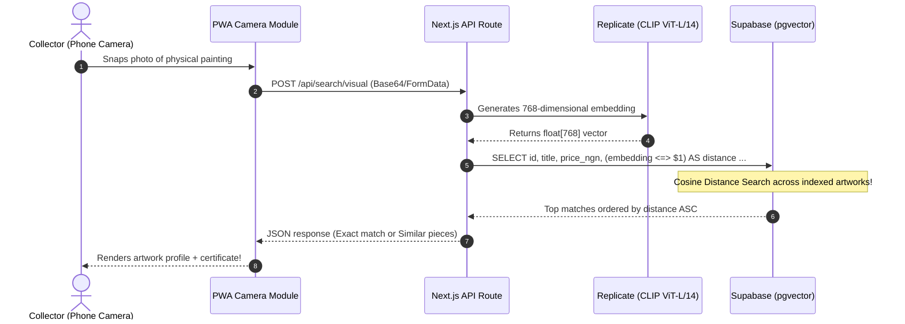
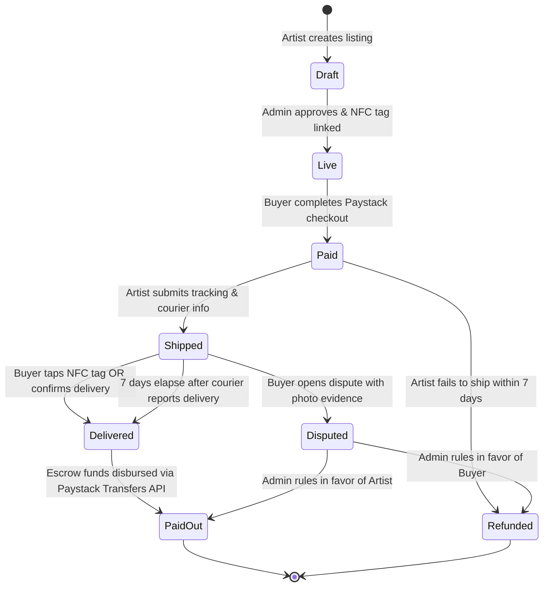

# Ọjà Ọnà — System Architecture & Design Guide

> **Mission:** A mobile-first marketplace (PWA) connecting contemporary Nigerian artists with collectors through escrow-backed commerce, on-chain provenance certificates (Base L2), tamper-evident physical NFC links, and AI visual search.

---

## 1. System Overview: "Thin Edges, Pure Core"

The Ọjà Ọnà platform is engineered with a strict unidirectional flow where edge clients and external third parties interact through typed server boundaries, keeping core business and escrow logic deterministic and isolated.



---

## 2. The 5 Core Engines

### 1. Catalog & Media Pipeline
- **Image Processing:** High-resolution artwork images uploaded by artists are stored in Supabase Storage.
- **Thumbnail & Optimization:** Next.js Image Optimization serves WebP/AVIF formats at responsive widths (mobile viewports), ensuring sub-second cold loads over 3G/4G Nigerian mobile networks.
- **Relational Integrity:** Every artwork record contains exact physical dimensions, medium categorization, creation year, and 3 flat shipping rates (Lagos, National, International).

---

### 2. Visual Search & Similarity Engine (`pgvector` + CLIP)



#### Vector Math & Indexing Strategy
- **Embedding Dimensions:** 768 dimensions output by the OpenAI CLIP model.
- **Distance Metric:** Cosine Distance:
  $$\mathcal{D}_{\text{cosine}}(\vec{u}, \vec{v}) = 1 - \frac{\vec{u} \cdot \vec{v}}{\|\vec{u}\|_2 \|\vec{v}\|_2}$$
- **Postgres Indexing:** HNSW (Hierarchical Navigable Small World) index configured for rapid approximate nearest neighbor search:
  ```sql
  CREATE INDEX idx_artwork_images_embedding 
  ON artwork_images 
  USING hnsw (embedding vector_cosine_ops) 
  WITH (m = 16, ef_construction = 64);
  ```
- **Threshold Rules:**
  - $\text{distance} \le 0.15$: **High Confidence Match** $\to$ Direct redirect to artwork certificate page.
  - $0.15 < \text{distance} \le 0.35$: **Visual Similarity** $\to$ Display carousel of visually related paintings.
  - $\text{distance} > 0.35$: No confident match $\to$ Prompt user to refine camera angle or lighting.

---

### 3. Provenance & On-Chain Certificate Engine (Base L2)
- **Token Standard:** ERC-721 non-fungible token deployed on Base (Ethereum Layer 2).
- **Why Base?** Ethereum mainnet gas fees ($5–$30) would ruin unit economics for a ₦150,000 painting. Base offers sub-cent minting fees ($< $0.01) with Ethereum-grade security and instant transaction finality.
- **Metadata Immutability:** Token metadata holds:
  ```json
  {
    "name": "Eko at Twilight",
    "artist": "Babatunde Adeleke",
    "medium": "Acrylic on Canvas",
    "dimensions": "120cm x 90cm",
    "year": 2026,
    "image_sha256": "e3b0c44298fc1c149afbf4c8996fb92427ae41e4649b934ca495991b7852b855",
    "nfc_uid": "04A1B2C3D4E5F6"
  }
  ```
- **Frictionless Wallets (Privy):** Neither buyers nor artists need to install MetaMask or understand seed phrases. Email or SMS authentication generates an embedded, non-custodial smart wallet automatically.

---

### 4. Physical NFC & Anti-Tamper Verification Engine
- **Hardware:** **NTAG 424 DNA** tamper-evident adhesive tags placed across the canvas stretcher bar.
- **Cryptographic Security (SUN - Secure Unique NFC):**
  - Unlike standard NFC or static QR codes that anyone can photograph and clone, NTAG 424 DNA generates a dynamic AES-128 cryptographic signature (CMAC) on every single tap:
    ```text
    https://ojaona.art/verify?uid=04A1B2C3D4E5F6&ctr=000018&cmac=9F8E7D6C5B4A3120
    ```
  - The Ọjà Ọnà backend verifies the CMAC using a master key. If someone copies the URL, the counter mismatch causes immediate cryptographic rejection.
- **Physical Tamper Detection:** Attempting to peel the sticker breaks an antenna circuit, signaling that the artwork tag has been tampered with.

---

### 5. Escrow State Machine & Settlement Engine



#### Invariants Enforced by the State Machine
1. **Zero Client Trust:** Pricing is computed strictly on the server based on `artworks.price_ngn + selected_shipping_rate`. Client-submitted price values are ignored.
2. **Atomic Transition:** Orders cannot jump states (e.g. `paid` directly to `paid_out` without passing through `shipped` and `delivered`).
3. **Webhook Idempotency:** Paystack webhooks (`charge.success`, `transfer.success`) store unique transaction references. Duplicate webhook events are discarded safely without double-crediting.
4. **Auto-Confirmation Timer:** Once courier APIs show successful transit, a 7-day countdown begins. If no dispute is filed, delivery is auto-confirmed, preventing artists from having funds frozen by unresponsive buyers.

---

## 3. Database Security & Row Level Security (RLS)

All client queries interact with Supabase through strict Row Level Security policies:

```sql
-- Artworks table: Anyone can read live artworks; only artists can edit their own drafts
ALTER TABLE artworks ENABLE ROW LEVEL SECURITY;

CREATE POLICY "Public can view live artworks"
  ON artworks FOR SELECT
  USING (status = 'live');

CREATE POLICY "Artists can view and update their own artworks"
  ON artworks FOR ALL
  USING (auth.uid() = artist_id);

CREATE POLICY "Admins have full access"
  ON artworks FOR ALL
  USING (auth.jwt() ->> 'role' = 'admin');

-- Orders table: Strictly scoped to the buyer, the artist, and the admin
ALTER TABLE orders ENABLE ROW LEVEL SECURITY;

CREATE POLICY "Buyers can view their own orders"
  ON orders FOR SELECT
  USING (auth.uid() = buyer_id);

CREATE POLICY "Artists can view orders for their artworks"
  ON orders FOR SELECT
  USING (auth.uid() IN (SELECT artist_id FROM artworks WHERE id = orders.artwork_id));
```

---

## 4. Architectural Decisions to Defend

| Architectural Decision | Why We Chose It | Trade-Off & Defense |
| :--- | :--- | :--- |
| **Mobile PWA over Native App** | Zero app store commissions (30%), instant web updates, direct WhatsApp/Instagram link sharing. | Safari does not support Web NFC API directly; mitigated because iOS natively opens NTAG NFC URLs directly in Safari without any app. |
| **Supabase `pgvector` over Pinecone** | Single database for relational data, auth, storage metadata, and vector embeddings. Zero cross-service sync lag. | Pinecone handles billions of vectors; Supabase easily handles 100,000+ vectors with HNSW indexing at a fraction of the cost. |
| **Base L2 over Ethereum Mainnet** | Minting certificates costs $< $0.01 on Base vs $5–$30 on Ethereum. Fast 2-second block finality. | Newer ecosystem than Ethereum mainnet; backed by Coinbase with strong developer tooling. |
| **Paystack over Stripe-Only** | Paystack is native to Nigeria: supports NGN cards, bank transfers, USSD, and direct Naira bank payouts via Transfers API. | Stripe has limited merchant support for Nigerian bank payouts without offshore entities. |
| **NTAG 424 DNA over Standard QR Code** | Standard QR codes can be easily photographed, cloned, and printed. NTAG 424 DNA uses dynamic AES-128 CMAC signatures. | Slightly higher physical unit cost (~€0.80/tag vs free paper QR); essential to establish trust for high-value physical art. |
| **Admin-Moderated Version 1 Payouts** | Manual payout approval in v1 allows human verification of courier tracking and dispute prevention. | Introduces minor operational overhead; prevents automated payout drain attacks during initial launch. |

---

## 5. Review & Interview Quick Reference

- **"Why does Ọjà Ọnà use an escrow model instead of direct payment to artists?"**  
  High-value art commerce requires mutual trust. Buyers fear paying strangers on social media without receiving authentic work; artists fear shipping pieces without guaranteed payment. Escrow protects both parties.
- **"How does visual search work without an expensive AI server?"**  
  We separate embedding generation from similarity search. Replicate's hosted CLIP model generates the 768-dimensional float vector on upload and scan; PostgreSQL's native `pgvector` extension executes the cosine distance calculation in-database in milliseconds.
- **"How does the platform handle iPhones if Safari lacks Web NFC?"**  
  Safari does not expose the JavaScript `NDEFReader` API, but iOS itself natively scans NFC tags in the background. Tapping an NTAG 424 tag prompts iOS to open the certificate URL directly in Safari. Android Chrome supports direct in-browser Web NFC.
- **"How do you prevent a fake copy of a painting from being verified?"**  
  Three-way binding: (1) The physical tamper-evident NTAG 424 tag, (2) The high-resolution photo SHA-256 hash stored on-chain in the ERC-721 token on Base, and (3) The visual similarity vector matching the physical piece.
