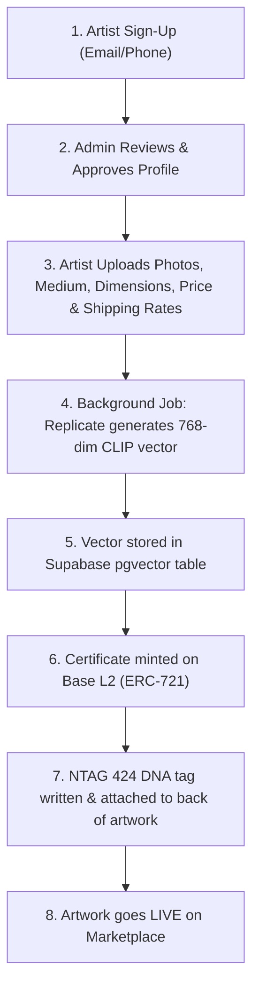
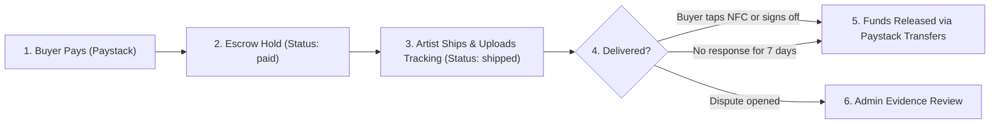
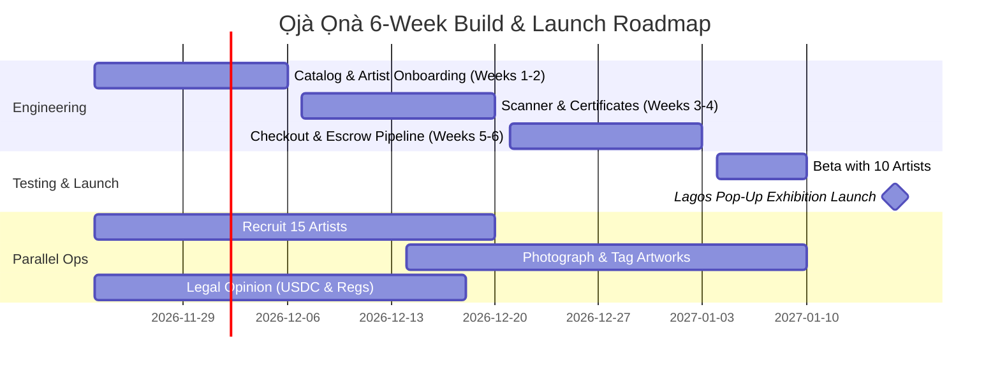

# Ọjà Ọnà — MVP Plan & Specification

**Author:** @Tony  
**Date:** Nov 18, 2026  
**Document Status:** Approved MVP Specification

---

## 1. Overview & Mission

**Ọjà Ọnà** (*"art market"* in Yoruba) is a mobile-first marketplace (Progressive Web App) where contemporary Nigerian artists sell original physical artworks, each cryptographically paired with an immutable digital certificate of authenticity on Base L2 and an anti-tamper physical NFC sticker.

### The Market Gap
- **For Nigerian Artists:** Artists currently rely on Instagram DMs, unverified bank transfers, and traditional physical galleries that often delay payouts for months or take exorbitant 40–50% commissions.
- **For Collectors (Local & Diaspora):** Buyers struggle to find genuine African art, verify artist provenance, and send substantial payments to individuals without protection against counterfeit pieces or non-delivery.

### What the MVP Must Prove (in 6 Weeks + Launch Event)
1. **Escrow Adoption:** Artists will list original work and handle shipping when payment is guaranteed by escrow.
2. **Buyer Confidence:** Collectors will purchase art from unfamiliar artists when an escrow mechanism and a verifiable certificate protect them.
3. **Scan-to-Search Utility:** Physical gallery visitors will actively use phone-camera visual scanning to discover artwork details and provenance during exhibitions.

### 90-Day Post-Launch Targets
- **15** verified artists onboarded.
- **60** original physical artworks listed.
- **10** completed escrow sales transactions.

---

## 2. MVP Scope (In v1 vs Out of v1)

The MVP is engineered as a lightweight, lightning-fast **Progressive Web App (PWA)** for mobile browsers rather than a native app store download. This eliminates app-store approval gates, enables instant URL sharing across WhatsApp and Instagram, and minimizes initial engineering overhead.

| Capability | In Version 1 (MVP) | Out of Version 1 (Post-MVP) |
| :--- | :--- | :--- |
| **Platform** | Mobile PWA (Next.js + Tailwind on Vercel) | Native iOS & Android apps (App Store / Play Store) |
| **Artist Profiles** | Sign-up, verified profile, multi-photo listings, 3 flat shipping rates | Self-service multi-collaborator studio accounts |
| **Catalog Search** | Keyword, medium, price filters & vector visual search | AI-assisted natural language curation & voice search |
| **Camera Discovery** | In-app camera photo to CLIP vector search (`pgvector`) | Augmented reality (AR) wall visualization |
| **Local Payments** | Naira payments via Paystack (Cards, Bank Transfer, USSD), held in escrow | In-house automated split payments |
| **Diaspora Payments** | USDC on Base via licensed processor *(switched on after legal review)* | Direct credit card settlement for international buyers |
| **Provenance** | ERC-721 token minted on Base L2 containing artwork metadata | Secondary market resale royalties & fractional tokens |
| **Physical Link** | NTAG 424 DNA tamper-evident NFC stickers | Custom engraved hardware security tags |
| **Settlement** | Admin-moderated Paystack Transfers API payout release | Fully automated decentralized escrow smart contracts |
| **Disputes & Chat** | In-app dispute form with evidence photos + WhatsApp links | Native real-time in-app chat & multi-party video call |

> [!IMPORTANT]
> **Logistics Rule:** Artists handle physical packing and courier shipping themselves. The platform enforces this strictly: **no payout is released until a valid tracking number is submitted and the buyer confirms physical delivery via an NFC tap or manual confirmation.**

---

## 3. Core User Flows

### Flow 1: Artist Lists an Artwork


1. **Sign-Up:** Artist registers via email or phone. Admin approves the artist profile to maintain high catalog quality.
2. **Artwork Metadata:** Artist inputs title, medium, dimensions, year created, price (in NGN with USD equivalent), and 3 flat shipping rates:
   - Lagos metropolitan delivery.
   - Rest of Nigeria.
   - International shipping.
3. **Vision Processing:** The primary photo is dispatched to Replicate's CLIP model, which returns a normalized 768-dimensional embedding vector stored in `artwork_images`.
4. **Certificate & Tagging:** Once approved, an ERC-721 certificate is minted on Base L2. The artist or team programs an NTAG 424 DNA sticker and affixes it to the back of the physical canvas or frame.

---

### Flow 2: Buyer Discovers Artwork (Visual Scan & NFC)
1. **Visual Scan-to-Search:**
   - The user taps the camera icon in the PWA and snaps a photo of any artwork (at a gallery, cafe, or private collection).
   - The photo is vectorized via CLIP, and Supabase executes a cosine distance search:
     $$\text{distance} = 1 - (\vec{u} \cdot \vec{v})$$
   - If a high-confidence match is detected ($\text{distance} \le 0.15$), the app opens the exact artwork profile and its certificate.
   - If a looser match is found, the app displays a curated feed of *"Visually Similar Artworks"*.
2. **NFC Tap Discovery:**
   - Tapping an iPhone or Android phone to the artwork's NTAG 424 DNA tag opens the authenticated certificate page directly, displaying the artist, title, provenance history, and verified status.

---

### Flow 3: Buyer Purchases Artwork & Escrow Settlement


1. **Checkout:** The buyer selects a shipping destination (Lagos, Nigeria, or International) and pays through Paystack.
2. **Escrow Hold:** Funds enter Ọjà Ọnà's dedicated escrow account. The order status updates to `paid`. The artist receives an automated SMS/WhatsApp dispatch alert.
3. **Fulfillment:** The artist securely packs the painting, ships it via courier, and inputs the tracking code and courier name. Status moves to `shipped`.
4. **Physical Delivery & Proof:**
   - The buyer receives the package and taps the physical NFC tag using their phone.
   - The cryptographically signed tap registers with the Ọjà Ọnà API, verifying that the genuine artwork arrived in person.
   - Alternatively, the buyer clicks *"Confirm Delivery"* in their order dashboard.
   - **7-Day Auto-Confirm Rule:** If the courier tracking API confirms package delivery and the buyer takes no action for 7 days without raising a dispute, the system automatically transitions the order to `delivered`.
5. **Payout:** The platform takes a small commission, and the remaining funds are disbursed to the artist's registered Nigerian bank account via the Paystack Transfers API. Status moves to `paid out`.

---

## 4. Technology Stack & Service Integrations

| Architectural Layer | Selected Technology | Technical Justification |
| :--- | :--- | :--- |
| **Frontend Framework** | **Next.js (App Router, React 19)** | Native PWA support; server components keep API credentials hidden; SSR outputs OpenGraph tags for rich WhatsApp and Instagram link previews. |
| **Styling** | **Tailwind CSS** | Clean mobile-first utility classes and minimal bundle size. |
| **Database & Auth** | **Supabase (PostgreSQL 16)** | Houses user accounts, relational catalog data, and high-resolution artwork image storage buckets. |
| **Vector Search Engine** | **Supabase `pgvector` + CLIP** | Uses OpenAI's open-weights CLIP model running on Replicate to output 768-dimensional embeddings. Storage and similarity search live in the same PostgreSQL database. (~$0.0004 per scan). |
| **Naira Payments** | **Paystack** | Robust coverage for Nigerian cards, direct bank transfers, and USSD. Provides Paystack Transfers API for direct bank payouts. *(Flutterwave configured as backup).* |
| **Diaspora Payments** | **USDC on Base** | Stablecoin payments over Base L2 with sub-cent gas fees via a licensed third-party processor. |
| **Embedded Wallets** | **Privy** | Invisible Web3 onboarding: email or phone OTP login provisions a non-custodial wallet with zero seed phrase friction. |
| **Certificates** | **ERC-721 on Base** | Minting cost is under $0.01 per token. Stores token metadata including artist name, artwork title, dimensions, creation year, and sha256 image hash. |
| **Physical Authentication** | **NTAG 424 DNA NFC** | Secure Unique NFC (SUN) cryptographic message authentication code (CMAC) prevents tag cloning or tampering. |

### Technical Device Caveat: Web NFC vs iOS
- **Android Chrome:** Natively supports the browser `Web NFC` API for both reading and writing tags.
- **Apple iOS (Safari):** Does not support the browser `Web NFC` API. However, iOS natively reads NFC tags at the OS level and opens the embedded URL in Safari. Therefore:
  - Any iPhone user can tap tags to view certificates and verify delivery without installing any app.
  - Initial tag writing requires an Android phone (operated by the Ọjà Ọnà team or the artist during onboarding).

---

## 5. Relational Data Model

The MVP schema is structured across six primary tables in PostgreSQL:

```text
users
  id                     uuid PRIMARY KEY DEFAULT gen_random_uuid()
  name                   varchar(255) NOT NULL
  email                  varchar(255) UNIQUE
  phone                  varchar(50) UNIQUE
  role                   varchar(20) NOT NULL CHECK (role IN ('buyer', 'artist', 'admin'))
  wallet_address         varchar(66)
  bank_details           jsonb -- { account_number, bank_code, account_name, recipient_code }
  created_at             timestamptz DEFAULT now()

artworks
  id                     uuid PRIMARY KEY DEFAULT gen_random_uuid()
  artist_id              uuid NOT NULL REFERENCES users(id)
  title                  varchar(255) NOT NULL
  medium                 varchar(100) NOT NULL -- 'Oil on Canvas', 'Acrylic', etc.
  size                   varchar(100) NOT NULL -- '120cm x 90cm'
  year                   int NOT NULL
  price_ngn              numeric(12,2) NOT NULL
  price_usd              numeric(10,2)
  shipping_lagos         numeric(10,2) NOT NULL DEFAULT 0
  shipping_nigeria       numeric(10,2) NOT NULL DEFAULT 0
  shipping_intl          numeric(10,2) NOT NULL DEFAULT 0
  status                 varchar(20) NOT NULL DEFAULT 'draft' CHECK (status IN ('draft', 'live', 'sold'))
  created_at             timestamptz DEFAULT now()

artwork_images
  id                     uuid PRIMARY KEY DEFAULT gen_random_uuid()
  artwork_id             uuid NOT NULL REFERENCES artworks(id) ON DELETE CASCADE
  url                    text NOT NULL
  embedding              vector(768) -- pgvector 768-dim CLIP vector
  is_primary             boolean NOT NULL DEFAULT false
  created_at             timestamptz DEFAULT now()

certificates
  id                     uuid PRIMARY KEY DEFAULT gen_random_uuid()
  artwork_id             uuid NOT NULL UNIQUE REFERENCES artworks(id)
  token_id               varchar(100) NOT NULL
  contract_address       varchar(66) NOT NULL
  owner_wallet           varchar(66) NOT NULL
  nfc_tag_uid            varchar(100) UNIQUE
  minted_at              timestamptz DEFAULT now()

orders
  id                     uuid PRIMARY KEY DEFAULT gen_random_uuid()
  artwork_id             uuid NOT NULL REFERENCES artworks(id)
  buyer_id               uuid NOT NULL REFERENCES users(id)
  amount                 numeric(12,2) NOT NULL
  currency               varchar(10) NOT NULL CHECK (currency IN ('NGN', 'USDC'))
  payment_reference      varchar(100) UNIQUE NOT NULL
  status                 varchar(20) NOT NULL DEFAULT 'paid' CHECK (status IN ('paid', 'shipped', 'delivered', 'paid_out', 'disputed', 'refunded'))
  tracking_number        varchar(100)
  courier                varchar(100)
  created_at             timestamptz DEFAULT now()
  shipped_at             timestamptz
  delivered_at           timestamptz
  paid_out_at            timestamptz

disputes
  id                     uuid PRIMARY KEY DEFAULT gen_random_uuid()
  order_id               uuid NOT NULL UNIQUE REFERENCES orders(id)
  opened_by              uuid NOT NULL REFERENCES users(id)
  reason                 text NOT NULL
  evidence_photos        text[] DEFAULT '{}'
  resolution             varchar(20) CHECK (resolution IN ('refund_buyer', 'pay_artist'))
  resolved_at            timestamptz
```

---

## 6. 6-Week Engineering Roadmap



- **Weeks 1–2 (Nov 23 – Dec 6):** Build Supabase schemas, artist registration, artwork photo uploads, and responsive catalog browsing.
- **Weeks 3–4 (Dec 7 – Dec 20):** Integrate Replicate CLIP embedding worker, Supabase `pgvector` cosine similarity queries, Base ERC-721 smart contract, and NTAG 424 DNA URL routes.
- **Weeks 5–6 (Dec 21 – Jan 3):** Implement Paystack checkout, webhook event handlers, escrow state transitions, admin moderation dashboard, and Paystack Transfers API.
- **Beta Week (Jan 4 – Jan 10):** Run complete dry-runs with 10 selected artists in Lagos.
- **Launch Day (Saturday, Jan 16, 2027):** Live pop-up exhibition in Lagos showcasing 60 tagged artworks available for instant scanning, purchase, and escrow delivery.

---

## 7. Budget & Economics

### Monthly Cloud Software Infrastructure (Post-Launch)
- **Supabase Pro:** $25/mo (~₦35,000) — prevents projects pausing on idle, supports production `pgvector`.
- **Vercel Pro:** ~$20/mo (~₦28,000) — custom domains, fast edge routing, team collaboration.
- **Privy Embedded Wallets:** ₦0 (Free tier covers up to 499 Monthly Active Users).
- **Replicate CLIP API:** < ₦1,000 (~$0.0004 per image embedding; 1,000 scans cost ~$0.42).
- **Base L2 Gas Fees:** < ₦1,000 (< $0.01 per minted certificate).
- **Total Fixed Software Run-rate:** **~₦65,000 / month**.

### Payment Processing Fees (Paystack)
- **Local Nigerian Cards / Bank Transfers / USSD:** 1.5% + ₦100, **strictly capped at ₦2,000** (e.g. a ₦300,000 artwork incurring only ₦2,000 in payment fees).
- **International Cards:** 3.9% + ₦100 (uncapped).
- **Payout Transfer to Artist Bank:** ₦50 flat fee per transfer over ₦50,000.

### One-Off Launch Expenses
- **NTAG 424 DNA NFC Stickers (100 pcs):** ~€80–110 (~€0.76–1.09 per tag) + shipping to Lagos.
- **Domain Registrations (`ojaona.com` + `ojaona.ng`):** Standard annual registrar fees.
- **CAC Business Registration:** Official portal fee for Nigerian business registration.
- **Fintech Legal Opinion:** 2–3 quotes from Lagos fintech attorneys regarding escrow and crypto compliance.
- **Lagos Pop-up Launch Event:** Hosted in partnership with a local art café/gallery to minimize venue rental fees.

---

## 8. Nigerian Regulatory & Compliance Framework

> [!CAUTION]
> **Legal Strategy:** Launch Version 1 with **Naira payments and digital certificates first**. Only activate USDC stablecoin settlement after obtaining written clearance from a qualified Nigerian fintech attorney.

### Key Regulatory Considerations
1. **SEC & Virtual Assets (ISA 2025):** The *Investments and Securities Act 2025* classifies digital assets and tokens as securities. The SEC enforces strict licensing for Virtual Asset Service Providers (VASPs), with proposed capital thresholds far exceeding early-stage MVP budgets (₦200M–₦1B).
2. **Mitigating VASP Risk Through Architecture:**
   - **Never Hold Crypto Directly:** All stablecoin transactions flow through a licensed third-party processor. Ọjà Ọnà's servers never hold custodial control over buyer or seller crypto assets.
   - **Certificates Are Provenance Records, Not Investment Tokens:** Certificates cannot be traded independently of the physical art. They are non-fungible provenance deeds verifying ownership of physical work.
   - **No Speculative Financial Features:** Fractional ownership, secondary royalty trading, and yield mechanisms are explicitly excluded from Version 1.
   - **Non-Custodial Wallets:** Privy ensures users retain private keys; Ọjà Ọnà does not act as a custodial digital asset bank.
3. **Escrow & CBN Guidelines:** Holding client funds in escrow must be structured through licensed commercial payment partners (Paystack / commercial bank escrow accounts).

---

## 9. Brand & Launch Strategy

- **Typography System:**
  - **Ogaranya Regular** (Display Serif by Nebo Ikechukwu Kingsley): Custom display font for brand identity, headers, artwork names, and Naira amounts (`₦`). Fully supports Nigerian tone marks (`Ọ`, `ọ`, `Ẹ`, `ẹ`, `Ṣ`, `ṣ`, `à`, `á`).
  - **Inter / Manrope:** Clean sans-serif for body typography, forms, data badges, and status labels.
- **Licensing Constraint:** *Ogaranya Font Licence v1.0* allows free commercial web and branding usage, but strictly prohibits redistributing font files or publishing raw font files in open repositories.
- **Official Brand Handles:** Target handles across Instagram, X (Twitter), and TikTok:
  - Primary: `@ojaona.art` | Alternatives: `@ojaonaapp`, `@ojaona.ng`, `@shopojaona`.
